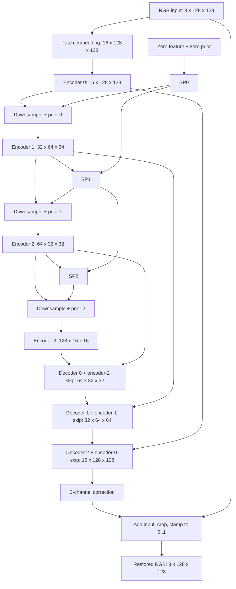

# Master guide: understanding the architecture, implementation, and model lifecycle

**Project:** AIRFormer-inspired all-in-one weather-degraded image restoration  
**Workspace:** `D:\Multi_adverse_weather_image_enhancement`  
**Verified state:** 9 November 2026; 20 training epochs and all 14,695 test pairs completed.

This guide explains how the research ideas became working PyTorch code, where each responsibility lives, why implementation decisions were made, and what happened from data preparation to the final report. It describes the **actually trained small configuration**, rather than silently substituting the larger repository defaults.

The architectural reference was the supplied main paper: Tao Gao et al., *Frequency-Oriented Efficient Transformer for All-in-One Weather-Degraded Image Restoration*, IEEE TCSVT, 2024. The authors' implementation, pretrained weights, and complete supplementary specification were not available during reconstruction. The project therefore implements the paper's broad ideas with explicitly documented assumptions. It is an **independent paper-guided reconstruction**, not a verified exact copy of the authors' model. PyTorch and standard mathematical operations provide the implementation building blocks.

## How to use this guide

Read sections 1-5 for the overall picture; sections 6-8 while opening the model source; sections 9-13 for the full experiment; and sections 14-18 when preparing to explain the work to your guides.

1. [What problem the model solves](#1-what-problem-the-model-solves)
2. [How the paper was translated into implementation decisions](#2-how-the-paper-was-translated-into-implementation-decisions)
3. [Directory map and entrypoints](#3-directory-map-and-entrypoints)
4. [Notation and the trained configuration](#4-notation-and-the-trained-configuration)
5. [Complete forward pass and verified shapes](#5-complete-forward-pass-and-verified-shapes)
6. [Encoder and supplementary-prior logic](#6-encoder-and-supplementary-prior-logic)
7. [Decoder and the three attention mechanisms](#7-decoder-and-the-three-attention-mechanisms)
8. [Loss implementation and backpropagation](#8-loss-implementation-and-backpropagation)
9. [Dataset preparation and split logic](#9-dataset-preparation-and-split-logic)
10. [Training implementation](#10-training-implementation)
11. [Checkpoints, pauses, and recovery](#11-checkpoints-pauses-and-recovery)
12. [Full testing and reporting](#12-full-testing-and-reporting)
13. [Using the saved model for inference](#13-using-the-saved-model-for-inference)
14. [What was verified](#14-what-was-verified)
15. [Work completed at each lifecycle stage](#15-work-completed-at-each-lifecycle-stage)
16. [Final results and measured durations](#16-final-results-and-measured-durations)
17. [How to explain the contribution accurately](#17-how-to-explain-the-contribution-accurately)
18. [Study order and guide questions](#18-study-order-and-guide-questions)

## 1. What problem the model solves

An input image contains rain streaks, adherent raindrops, snow, or haze. The desired output is an RGB image of the same scene with reduced degradation. Training needs paired degraded and clean images:

```text
degraded RGB image x -> learned restoration function f_theta(x) -> restored RGB image
                                                                   |
                                                        compare with clean target y
```

`theta` denotes trainable weights. Optimization changes these weights so the prediction approaches the clean target. At demonstration time, only the degraded image and saved weights are needed; a clean target is needed for quantitative evaluation, not ordinary inference.

This is supervised **image-to-image regression**. There is no weather-classification head, predicted class label, or weather-label input to `AIRFormer.forward`. Weather metadata is used for dataset organization, balanced training sampling, and grouped evaluation. The learned task-query parameters are internal feature parameters; they are not supplied weather labels.

## 2. How the paper was translated into implementation decisions

The reconstruction process was: identify a paper component, specify its inputs and outputs, choose concrete tensor operations, implement a module, then check its behavior. Where the main paper did not establish an exact operator or numerical setting, the choice was documented instead of being presented as an author setting.

| Paper reference or idea | Translation into code | Evidence boundary |
|---|---|---|
| Figure 4: hierarchical encoder | Four feature positions with downsampling and increasing channels | Four positions follow the figure; widths/depths are chosen settings |
| PoolFormer-style mixing | GroupNorm, local average-pooling residual, channel/depthwise MLP | Exact normalization, activation, kernels, and MLP ratio are assumptions |
| Equation 9: wavelet decomposition | Explicit differentiable Haar DWT and IDWT | Haar family, normalization, and odd-boundary rules are choices |
| Figure 4 / Equation 10: recurrent supplementary priors | Three priors injected after downsampling and before the next encoder block | Routing corrected; filtering/fusion/alignment internals remain an approximation |
| Figure 5: queried attention in three domains | Shared attention class with channel, spatial, and wavelet modes | Broad axes/branches implemented; task-query composition remains assumed |
| Table XII: refinement order | Channel -> Space -> Wavelet | Order supported; this does not certify the internals of each block |
| Reconstruction tail | Upsample, concatenate encoder skips, project/refine, RGB convolution, image residual | Concrete tail topology is an implementation choice |
| Equations 11-13: spatial/frequency consistency | Smooth L1 plus a weighted orthonormal DCT-II norm | The implemented Smooth L1 reduction differs from literal printed Equation 12 |
| Section IV-B: test padding | Symmetric multiple-of-128 padding followed by cropping | Size policy follows the paper; reflect/replicate boundary handling is chosen |

The early implementation and review exposed discrepancies, including the encoder stage count and wavelet/prior routing. The later corrections are recorded in [the architecture review](architecture/README.md) and [activity log](LOG.md). Older audit documents describe earlier snapshots and should not replace the current source or final checkpoint configuration.

The supplied PDF and extracted diagrams are linked in [the paper comparison](PAPER_COMPARISON.md#sources-and-verification). Figures 4 and 5 are also available in the architecture review. The [assumptions document](architecture_assumptions.md) records remaining specification gaps.

## 3. Directory map and entrypoints

All paths in the following tree are relative to the workspace root.

```text
Multi_adverse_weather_image_enhancement/
  README.md                         Project overview and documentation links
  train.py                          Thin entrypoint -> scripts/train.py
  inference.py                      Thin entrypoint -> scripts/infer.py
  evaluate.py                       Entrypoint for paired saved-image evaluation
  models/                           Canonical architecture implementation
    airformer.py                    Builds the complete network; forward pass
    patch_embed.py                  Dense RGB-to-feature projection
    encoder.py                      Encoder blocks, stages, and prior injection
    supplementary_prior.py          Haar DWT/IDWT and recurrent prior module
    attention.py                    Channel/spatial/wavelet queried attention
    decoder.py                      Skip fusion and ordered decoder refinement
  losses/multidomain.py              Canonical differentiable training objective
  airformer/                        Public imports and dataset implementation
    model.py                        Re-exports models.airformer.AIRFormer
    losses.py                       Re-exports losses.multidomain functions
    data.py                         PairedWeatherDataset
  datasets/                         Source metadata, archive/pair/split logic
    archive.py                      Safe archive extraction
    pairing.py                      Manifest writing and leakage checks
    splitting.py                    Grouped custom train/test split
    weather_dataset.py              Compatibility import for the same dataset
  data/
    raw/                            Downloaded archives and extracted source data
    manifests/four_weather/         Exact manifests used by the completed run
  configs/four_weather_fast.yaml    Actual trained experiment settings
  scripts/                          Preparation, training, testing, profiling
  utils/inference.py                Load weights, pad, restore, optional tiling
  utils/metrics.py                  RGB PSNR and SSIM protocol
  tests/                           Behavioral and integration verification
  checkpoints/                     Saved weights, optimizer state, training logs
  outputs/                         Numeric results, charts, and browser report
  docs/                            Markdown documentation and audit evidence
    LOG.md                         Durable dated work history
    architecture/                  Paper figures, architecture review, traces
    reports/                       Generated Markdown reports
```

Useful direct source links:

| Responsibility | File to open |
|---|---|
| Complete model | [models/airformer.py](../models/airformer.py) |
| Encoder | [models/encoder.py](../models/encoder.py) |
| Supplementary prior and wavelets | [models/supplementary_prior.py](../models/supplementary_prior.py) |
| Decoder | [models/decoder.py](../models/decoder.py) |
| Attention equations in executable form | [models/attention.py](../models/attention.py) |
| Loss | [losses/multidomain.py](../losses/multidomain.py) |
| Dataset loader | [airformer/data.py](../airformer/data.py) |
| Training loop | [scripts/train.py](../scripts/train.py) |
| Final full-test pipeline | [scripts/test_restoration.py](../scripts/test_restoration.py) |
| Inference utilities | [utils/inference.py](../utils/inference.py) |

The `airformer` public package does not define a second competing network. Its model/loss files import the canonical implementations. Similarly, `datasets/weather_dataset.py` exposes the same paired dataset through a compatibility name.

## 4. Notation and the trained configuration

PyTorch images use **NCHW** layout: `[B, C, H, W]`. `B` is batch size, `C` channels, and `H/W` spatial dimensions. RGB has three channels. Feature channels are learned representations; they are not additional color bands.

| Trained setting | Value | Meaning |
|---|---|---|
| Base channels | 16 | Encoder widths become 16, 32, 64, 128 |
| Stage blocks | [1, 1, 1, 1] | One encoder block at each of four positions |
| Attention heads | 2 | Channels are split across two attention heads |
| Encoder mixer | Pooling | Local averaging branch rather than encoder self-attention |
| Decoder mode | Frequency | Channel, then space, then wavelet attention |
| Query combination | Add | Add a broadcast learned task vector to projected queries |
| Supplementary priors | Enabled | Three recurrent feature-prior modules |
| Spatial K/V pooling | Enabled | Resource approximation in spatial/wavelet attention |
| Maximum spatial tokens | 256 | Large K/V grids are pooled to 16 x 16 |
| Image residual | Enabled | RGB head predicts an additive correction |
| Training crop / batch | 128 x 128 / 8 | Fixed-size paired microbatches |
| Gradient accumulation | 1 | One microbatch per optimizer update |
| Training precision | CUDA mixed precision | Autocast plus gradient scaling |
| Test precision | FP32 | No autocast in the completed evaluation |
| Epochs | 20 | Fixed schedule; no validation-based early stopping |

Source: [actual configuration](../configs/four_weather_fast.yaml) and the final checkpoint's `model_config`. The larger default/paper-oriented configuration is different. Its parameter count must not be substituted for this trained model's count.

## 5. Complete forward pass and verified shapes

The following diagram describes the trained configuration. Sizes assume a 128 x 128 image; batch dimension is omitted for readability.



Each decoder stage includes Channel -> Space -> Wavelet refinement. Diagram arrows into an SP indicate its information inputs; downsampling of the main stream and prior computation are separate operations.

The shape table was checked by forward hooks on the saved epoch-20 model, using a synthetic `[1,3,128,128]` input in evaluation mode on CPU. The checkpoint weights were loaded, not retrained or updated. Full evidence: [trained model trace](architecture/trained_model_trace.json).

| Operation | Output shape | Main operation |
|---|---|---|
| Input | [1, 3, 128, 128] | Float RGB |
| Patch embedding | [1, 16, 128, 128] | 3 x 3 convolution, stride 1; GroupNorm |
| Encoder stage 0 | [1, 16, 128, 128] | Local mixing and MLP |
| Downsample + SP0; stage 1 | [1, 32, 64, 64] | Stride-2 convolution, prior addition, block |
| Downsample + SP1; stage 2 | [1, 64, 32, 32] | Same pattern |
| Downsample + SP2; stage 3 | [1, 128, 16, 16] | Same pattern |
| Decoder stage 0 | [1, 64, 32, 32] | Upsample deepest feature; concatenate 64-channel skip |
| Decoder stage 1 | [1, 32, 64, 64] | Upsample; concatenate 32-channel skip |
| Decoder stage 2 | [1, 16, 128, 128] | Upsample; concatenate 16-channel skip |
| RGB head | [1, 3, 128, 128] | 3 x 3 convolution |
| Final output | [1, 3, 128, 128] | Add input; crop; clamp |

Measured trainable parameter breakdown:

| Component | Parameters |
|---|---:|
| Patch embedding | 480 |
| Encoder, including downsampling | 190,512 |
| Three supplementary priors | 193,536 |
| Decoder | 227,472 |
| RGB reconstruction head | 435 |
| **Total** | **612,435** |

The main model also pads internally to a multiple of eight when required by its three downsampling operations. The evaluation utility applies the separate multiple-of-128 policy before calling the model. These two policies serve different purposes; a 128-divisible input already satisfies the internal rule.

## 6. Encoder and supplementary-prior logic

### 6.1 Dense patch embedding

[PatchEmbed](../models/patch_embed.py) maps RGB to a wider feature space with a learned convolution and `GroupNorm(1,C)`. With the trained defaults, kernel 3, stride 1, and padding 1 preserve the image grid. These are overlapping local projections, not non-overlapping classification patches that discard the dense spatial layout.

```python
# Conceptual summary of PatchEmbed.forward
features = group_norm(conv3x3(rgb))
```

### 6.2 FrequencyGuidedBlock

In [encoder.py](../models/encoder.py), the pooling-mode block computes:

```text
z = GroupNorm1(x)
x = x + (AveragePool3x3(z) - z)
output = x + MLP(GroupNorm2(x))
```

Average pooling mixes nearby positions. Subtracting `z` is part of the implemented PoolFormer-style residual mixer; the entire block should not be casually described as just a low-pass filter. Its behavior includes normalization, residuals, and a learned MLP.

The MLP uses a 1 x 1 convolution to expand channels by two, GELU, a depthwise 3 x 3 convolution, GELU, and a 1 x 1 projection back. A depthwise convolution applies a separate spatial filter per channel. The 1 x 1 projections mix information between channels. Residual additions retain an existing feature stream while learning modifications.

### 6.3 Hierarchy and downsampling

`HierarchicalEncoder` stores four stages in `nn.ModuleList`. Between stages, a learned 3 x 3 stride-2 convolution approximately halves height/width and doubles channels. Fine-resolution features preserve detail; deeper features cover broader image context. The encoder saves each stage output for decoder skip connections.

### 6.4 Haar DWT and IDWT

For each 2 x 2 region with entries `a,b,c,d`, [dwt2](../models/supplementary_prior.py) creates four coefficient bands:

```text
LL = ( a + b + c + d) / 2
LH = (-a - b + c + d) / 2
HL = (-a + b - c + d) / 2
HH = ( a - b - c + d) / 2
```

LL captures a local approximation; the other three bands encode directional changes. The exact direction names depend on the transform convention. Output shape is `[B,C,4,ceil(H/2),ceil(W/2)]`. Odd dimensions use replicate padding. `idwt2` applies the inverse combinations, interleaves reconstructed samples, and crops the padding.

These are differentiable tensor operations: gradient-based training can pass through both transforms. They have no learned transform basis. The detail filters and surrounding convolutions do learn. Haar and these boundary rules are engineering choices where the supplied main paper did not establish a unique numerical specification.

### 6.5 SupplementaryPrior internals

The prior module performs the following operations on its input feature:

1. Compute Haar coefficients.
2. Keep LL unchanged at the band-filtering step; apply a learned depthwise 3 x 3 filter to the three detail bands.
3. Pack all four bands into `4C` channels and bilinearly resize them to the feature grid. **This prior branch resizes coefficients; it does not IDWT them.** The separate decoder wavelet branch does use IDWT.
4. Project the previous prior to `C` channels, resizing its spatial grid if needed.
5. Concatenate current feature (`C`), packed bands (`4C`), and projected previous prior (`C`): `6C` input channels.
6. Apply learned fusion and residual refinement; use a stride-2 output projection to align with the next encoder stage.

Preserving LL during band filtering does not mean the whole prior preserves low frequencies unchanged. Subsequent fusion can modify the representation. The specific `6C` fusion/filter/alignment design is a documented approximation, not a proven literal reconstruction of the paper's SP internals.

### 6.6 Recurrent routing and the first-prior detail

Inside `HierarchicalEncoder.forward`, priors are added **after downsampling and before** the subsequent encoder block:

```text
stage0 = block0(embed(image))
prior0 = SP0(zero_feature_like_stage0, zero_prior_like_stage0)
stage1 = block1(down0(stage0) + prior0)
prior1 = SP1(stage1, prior0)
stage2 = block2(down1(stage1) + prior1)
prior2 = SP2(stage2, prior1)
stage3 = block3(down2(stage2) + prior2)
```

This is explanatory pseudocode for the implemented routing. The first SP receives zero tensors, as tested; it does not receive the RGB image or actual stage-0 feature. Its output need not be zero because learned convolution biases and subsequent operations can produce a nonzero prior. Later SPs receive the preceding enhanced feature and preceding prior. This distinction is important when explaining what the code actually executes.

## 7. Decoder and the three attention mechanisms

### 7.1 Skip-connected reconstruction

[HierarchicalDecoder](../models/decoder.py) starts from the deepest feature and visits encoder skips in reverse order. Each `DecoderStage`:

```text
upsample to skip size -> concatenate with skip -> 1x1 projection
-> 3x3 convolution -> GELU -> Channel/Space/Wavelet refinement
```

The first decoder stage concatenates 128 upsampled channels with a 64-channel skip, then projects 192 channels to 64. The next stages project 96 to 32 and 48 to 16. Encoder targets are never resized to hide a pairing problem; only internal decoder features are aligned to skips.

The skips bring detailed encoder features directly to reconstruction. Bilinear upsampling, these concatenations/projections, and repeating attention at each skip level are chosen reconstruction operations. The paper's broad reconstruction label does not fully specify this exact tail.

### 7.2 Shared attention mechanics

All three modes are implemented in [QueriedAttention](../models/attention.py). Each block normalizes channels at each spatial location using `LayerNorm(C)`, projects Q/K/V with learned 1 x 1 convolutions, applies attention, projects the result, and adds a residual. A second LayerNorm and depthwise/channel MLP form another residual branch.

Conceptually:

```text
attention(Q,K,V) = softmax(scale * Q @ transpose(K)) @ V
scale in this code = (channels_per_head)^(-1/2)
```

Softmax is over keys. PyTorch SDPA performs this calculation without requiring the Python code to build the entire logical matrix explicitly. `last_attention_shape` records the logical shape for inspection, even when probabilities are not stored as a complete tensor.

Here `M` means heads, `D=C/M`, and `N=H*W`. Learned task parameters have shape `[1,M,D,1]` for channel mode and `[1,M,1,D]` for spatial/wavelet modes. The trained configuration uses `q + task_query`. An optional gate mode exists but was not the trained choice. Add/gate composition is an assumption, not a recovered author implementation.

### 7.3 Channel attention

Q/K are rearranged to `[B,M,D,N]`, then normalized along spatial dimension `N`. Attention compares channel representations, giving logical logits `[B,M,D,D]`. The task vector is added after this normalization. The code explicitly keeps scale `D^(-1/2)` even though the matrix multiplication contracts over spatial positions; this is the actual implemented convention, not a claim about a uniquely specified paper scale.

At the shallow decoder level with `C=16`, `M=2`, and a 128 x 128 grid, the logical shape is **[1,2,8,8]**. Spatial area appears as the embedding dimension used inside that calculation, which explains the full-resolution CUDA issue discussed below.

### 7.4 Spatial attention

Q has shape `[B,M,N,D]`. With full keys, spatial attention would compare each position with every other position. The trained resource mode adaptively averages the K/V input grid to at most a 16 x 16 grid when it exceeds the 256-token cap. Queries remain at full resolution.

At the same shallow level, the trained logical logits are **[1,2,16384,256]**, rather than `[1,2,16384,16384]`. This reduces computation and memory by reducing the available key/value positions. It changes the attention problem and is therefore an approximation.

### 7.5 Wavelet attention and its separate inverse branch

Wavelet mode normalizes the original feature, applies DWT, packs `4C` coefficients into channels, and projects them to `C` at reduced resolution. Q still comes from the full-resolution normalized feature. K/V come from the wavelet-derived feature, with the same optional K/V pooling cap.

A separate route reshapes the projected wavelet feature as `[B,C/4,4,H/2,W/2]` and applies IDWT, producing `C/4` channels at the original resolution. The attention result has `C` channels. They are concatenated as `C + C/4` channels and projected back to `C` before the residual.

For `C=16`, the inverse branch contributes four channels, so the final wavelet projection receives 20 channels. IDWT is applied to the separate projected coefficient route, **not to the attention output**. This inverse route is formed before optional K/V pooling. With the trained cap, shallow wavelet attention also has logical shape **[1,2,16384,256]**.

### 7.6 Pooling versus chunking

Two resource mechanisms must be distinguished:

| Mechanism | What changes | Mathematical effect |
|---|---|---|
| K/V pooling, enabled in the trained run | Fewer keys/values | Approximate attention; changes information available to queries |
| Query chunking, used when the logical matrix exceeds a configured element budget | Queries are processed in groups; all current keys remain for every query | Preserves that attention calculation, apart from numerical differences |

During gradient-enabled chunked attention, activation checkpointing can recompute chunk intermediates during backward. This is separate from the whole-decoder `gradient_checkpointing` configuration, which was disabled in the final training run.

### 7.7 RGB output and residual learning

The final 16-channel feature is converted to RGB with a learned 3 x 3 convolution. The model adds the original input image, crops internal padding, and clamps values to [0,1]. The correction can represent changes needed to restore the image; it is not directly supervised as a separate weather mask.

Clamping is inside `AIRFormer.forward`, including during training. It bounds outputs but can give zero gradient for values saturated outside the interval. This is another implementation choice, not a demonstrated author-tail equivalence.

## 8. Loss implementation and backpropagation

[MultiDomainConsistencyLoss](../losses/multidomain.py) combines two terms:

```text
L_total = L_smooth1 + 0.04 * L_frequency
L_smooth1 = mean over B,C,H,W of SmoothL1(prediction - target)
L_frequency = batch mean of sqrt(sum over C,H,W of DCT_difference^2 + 0.001^2)
DCT_difference = DCT2(prediction) - DCT2(target)
```

Smooth L1 measures elementwise prediction error. Its conventional beta-one form is quadratic for absolute error below one and linear above one. DCT-II transforms each channel's spatial grid into cosine coefficients; it is not an FFT. The code constructs orthonormal bases and uses matrix multiplication along height and width. Low-precision inputs are promoted to FP32 for the DCT computation.

The full unweighted orthonormal DCT Frobenius norm preserves the pixel-space L2 norm mathematically. Consequently, this loss term does **not** apply a special larger weight to high frequencies simply because it is computed after DCT. Claims about the benefit of a particular frequency weighting or component require controlled experiments, which were not completed here.

The printed Equation 12 takes a signed spatial mean before the piecewise penalty; this implementation applies the penalty per element and then averages. These are different when positive and negative errors cancel. That ambiguity is explicitly documented instead of claiming literal equation parity.

Backpropagation computes derivatives from loss through the RGB head, decoder/attention, encoder/priors, and embedding. AdamW updates trainable convolution, normalization, and task-query parameters. Dataset pairing, metric calculation, file logging, and the fixed Haar/DCT bases are not independently learned modules.

The frequency term uses a per-image norm, not a per-pixel mean. Larger images can produce larger loss norms. Therefore, the final full-resolution test loss (~2.04949) and 128-crop training loss (~0.494056 at epoch 20) are not directly comparable as an overfitting test.

## 9. Dataset preparation and split logic

### 9.1 Source preparation

[prepare_local_archives.py](../scripts/prepare_local_archives.py) extracts and audits local archives, using [safe_extract](../datasets/archive.py) to check archive paths/types and avoid silently overwriting different files. Source metadata lives in [sources.csv](../datasets/sources.csv) and [downloads.csv](../datasets/downloads.csv). Local data files are generally excluded from Git because of size and source restrictions.

[verify_reside_mirror.py](../scripts/verify_reside_mirror.py) compared local haze content with a pinned unofficial Hugging Face ITS mirror. [Verification evidence](RESIDE_MIRROR_VERIFICATION.json) records revision `39300fc7deb9138a59d5489f91a2f86d14d62eb6` and the file checks. Matching mirror content identifies what was used; it does not turn the custom split into an official SOTS benchmark or establish the original archive download provenance.

[prepare_training_run.py](../scripts/prepare_training_run.py) prepares the final four-weather manifests from previously audited available-data manifests, verifies the mirror proof and required weather coverage, and preserves existing membership. The misleading-looking `dataset_root: datasets/AIR40K/train` configuration field is not proof of official AIR40K membership: this run actually loads explicit manifest paths, mostly under `data/raw/extracted/`.

### 9.2 Why manifests are used

A manifest row stores `input_path`, `target_path`, `weather_type`, `source_dataset`, `split`, and `scene_id`. The dataset opens the explicitly paired paths. It does not pair independent sorted file lists, which could silently match unrelated scenes.

| Weather | Train | Test |
|---|---:|---:|
| Rain | 10,080 | 2,520 |
| Raindrop | 688 | 173 |
| Snow | 39,998 | 10,002 |
| Haze | 8,000 | 2,000 |
| **Total** | **58,766** | **14,695** |

### 9.3 Split and leakage logic

[write_custom_manifests](../datasets/splitting.py) keeps known official tests separate, excludes pool items matching official test identities, and groups related items using source/scene identity, identical clean RGB pixel hashes, and identical input-file bytes. A union-find structure joins matching items before a seeded per-source group split.

Approximately 80% of groups go to training and 20% to testing. Because groups can contain different numbers of pairs, the final pair ratio need not be mathematically exactly 80/20. No validation set was created for this user-requested experiment. Known official tests are stored separately and were not used for this completed test result.

The trainer also calls [assert_disjoint_datasets](../datasets/pairing.py), checking cross-split scenes, paths, and clean-pixel hashes before optimization. Exact hashes cannot establish that all perceptually similar scenes are unrelated; near-duplicate control still depends on source metadata.

### 9.4 Dataset loading, crops, and augmentation

[PairedWeatherDataset](../airformer/data.py) converts matched inputs and targets to RGB, rejects different dimensions, applies the same crop and geometric transformations to both, and converts them to [0,1] tensors. Small training images are padded before cropping. Training applies paired flips, 90-degree turns, and paired MixUp with probability 0.5. MixUp uses the same mixing coefficient for degraded and clean tensors.

Validation/testing use `crop_size=None` and augmentation disabled, preserving original resolution. Weather balancing assigns each training image weight `1 / count_of_its_weather`. `WeightedRandomSampler` draws with replacement for `len(train_dataset)` samples per epoch. Expected weather contributions are balanced, but an epoch is not guaranteed to visit every distinct image once. Twenty epochs therefore do not mean every stored image was seen exactly twenty times.

## 10. Training implementation

The call chain is:

```text
train.py -> scripts.train.main -> YAML and CLI settings
-> datasets and leakage checks -> DataLoaders -> AIRFormer
-> loss + AdamW + scheduler + GradScaler -> epoch loop -> checkpoint
```

### 10.1 Initialization

[scripts/train.py](../scripts/train.py) reads YAML, applies command-line overrides, seeds Python/NumPy/PyTorch and workers, chooses CUDA when available, creates the model from configuration, and initializes the objective and optimizer. AdamW uses learning rate 0.0002, betas 0.9/0.999, and weight decay 0.0001. CosineAnnealingLR uses the fixed 20-epoch schedule and configured minimum 0.000001.

### 10.2 One optimizer update

The following is teaching pseudocode; the source additionally handles accumulation and diagnostics:

```python
model.train()
optimizer.zero_grad(set_to_none=True)
with autocast_if_cuda_enabled:
    prediction = model(degraded_batch)
    loss = loss_function(prediction, clean_batch)
scaled_loss.backward()
unscale_gradients()
clip_gradient_norm(max_norm=1.0)
optimizer_step_through_scaler()
update_scaler()
```

Autocast selects lower precision for suitable CUDA operations; GradScaler scales gradients to improve numerical range. FP16 overflow causes the scaler to skip the update and reduce its scale. Nonfinite raw loss is fatal; FP32 nonfinite gradient handling remains stricter. This recovery avoids treating every recoverable AMP overflow as a failed run.

The code supports gradient accumulation, including correct normalization for a short final accumulation window. The final fast configuration uses batch eight and accumulation one. An earlier batch-two/accumulation-four configuration had the same nominal effective batch size but lower synthetic throughput. The benchmark measured 10.08 versus 17.38 images/s under its controlled setup; that is not the measured end-to-end training rate.

### 10.3 End of epoch and checkpoint choice

After each epoch, the scheduler advances, mean training loss and learning rate are logged to TensorBoard, and `latest.pt` is saved. When a validation loader is configured, the trainer can save `best.pt` based on validation loss. **That branch was not used in this experiment.** With no validation, no test score chooses a checkpoint; epoch 20 is the fixed final model.

The original trainer attempts one final test after the epoch loop. Training checkpoints are saved before that evaluation, which allowed recovery from the later testing failure.

## 11. Checkpoints, pauses, and recovery

A checkpoint contains more than the model weights:

| Saved item | Why it matters |
|---|---|
| `model` | Learned parameters needed for inference |
| `model_config` | Rebuild the same architecture before loading parameters |
| `config` and `epoch` | Record experiment settings and completed schedule position |
| `optimizer` | AdamW's accumulated moments for continued optimization |
| `scheduler` | Continue learning-rate progression rather than restarting it |
| `scaler` | Continue AMP scaling state |
| `rng` | Python, NumPy, Torch, CUDA, and DataLoader-generator random state |
| `val`, `best_val` | Validation metadata; no validation selection in this run |

On resume, the code rejects a mismatching model configuration, restores available state, and starts at the next epoch. Restoring RNG supports continuity; it is not a universal claim of bitwise reproducibility across different hardware, libraries, or worker behavior.

The completed trajectory retained epochs 1-3, then 4-10, 11-16, and 17-20. Verified backups `epoch_003.pt`, `epoch_010.pt`, and `epoch_016.pt` allowed the next session to continue without starting from zero. Partial next-epoch progress was deliberately discarded at user-requested pauses. The final artifact is [epoch-20 latest.pt](../checkpoints/four_weather_resume_epoch17/latest.pt).

[run_training_job.py](../scripts/run_training_job.py) adds durable stdout/stderr capture, a process/status record, and activity-log entries around the trainer. Its failed status records the child process exit; it does not independently know whether the epoch loop or subsequent testing failed.

### The full-resolution attention failure

On 7 November, epoch 20 saved successfully. The subsequent final test crashed with `RuntimeError: cutlassF: no kernel found to launch!`. In channel attention, the spatial area is the embedding dimension; a full image exceeded a selected fused CUDA kernel's capabilities even though its channel-by-channel attention matrix was small.

The failure was reproduced with the saved model on a 512 x 384 image. [attention.py](../models/attention.py) now uses `sdpa_kernel(SDPBackend.MATH)` for CUDA channel attention, retaining the attention equation and scale. Spatial/wavelet attention still use their normal SDPA selection. The weights were not changed, and training was not repeated. Regression checks then covered full-resolution inference and CPU/CUDA output/gradient agreement.

The old supervisor status remains historical evidence. The new [evaluation status](../outputs/four_weather_test_epoch20_20261109/status.json) independently records successful completion. This is why an old entry saying “Training failed” does not mean the final trained model was lost.

## 12. Full testing and reporting

[test_restoration.py](../scripts/test_restoration.py) is the detailed evaluator created after the original final-test failure. It loads the fixed final checkpoint and its settings, rather than retraining the model or changing its architecture.


### 12.1 Before the full run

Preflight rejects duplicate test inputs, wrong split labels, scene/path overlap with training, unreadable files, and mismatched sizes. It fully decoded **all 14,695 pairs**. It also tested the largest padded image shape in every weather group through inference, metrics, and loss. The earlier trainer/split audit had separately checked clean-pixel identities.

The evaluator records SHA-256 signatures for the checkpoint, manifests, evaluator, attention source, and inference source. These bind a result set to specific evidence. Later code changes, including documentation-path changes, mean a repeat run should use a new output directory rather than mix new-version predictions with old rows.

### 12.2 During testing

Each pair is read at original resolution, converted to RGB float [0,1], padded symmetrically to multiples of 128, restored with no gradient recording, and cropped back. The completed run used FP32 and no tiling. Nonfinite outputs or wrong shapes fail explicitly; failed images are not silently dropped from the denominator.

For both degraded input and restored output, the evaluator computes PSNR, SSIM, MAE, MSE, and RMSE against the same clean target. It also records loss, inference timing, improvement, metadata, and auxiliary mask counts. Per-image CSV rows are flushed as evaluation progresses. `status.json` updates every 25 images with counts, speed, and an estimate of remaining time.

Resume checks existing row order and signatures before continuing. File locking prevents the same output directory from being used by two evaluator instances. The final state changes to completed only after numeric summaries and reports are created. `log_evaluation_completion.py` can append the actual final outcome to [docs/LOG.md](LOG.md).

### 12.3 What the measures mean

| Measure | Meaning in this experiment |
|---|---|
| PSNR | Pixel-error measure in dB; higher is better at fixed [0,1] range |
| SSIM | Local structural similarity; higher is better; RGB skimage protocol |
| MAE | Mean absolute RGB error; lower is better |
| MSE / RMSE | Squared-error measure / its square root; lower is better |
| Gain | Restored score minus input score on the same image |
| Loss | Implemented training objective evaluated at original image size |
| Inference seconds | Synchronized model-call timing, excluding decoding/CPU metrics |

PSNR uses `10 * log10(1 / MSE)` for the [0,1] data range. SSIM uses `data_range=1`, RGB channels, and a window of seven when image size permits, with no border crop. Overall restoration scores average individual images equally. They are not obtained by converting the overall average MSE to PSNR or by averaging four weather means. Reported RMSE is also averaged per image.

### 12.4 Requested auxiliary accuracy and confusion matrix

Because there are no classification predictions, the requested accuracy/precision/recall/F1 were defined as an approved extra diagnostic:

```text
true_positive_mask = mean_RGB(abs(input - target)) > threshold
predicted_positive_mask = mean_RGB(abs(input - restored)) > threshold
```

TN/FP/FN/TP compare these two masks. They describe whether the model made sufficiently large corrections at corrupted pixels, not whether the resulting color is correct. Counts are pooled over pixels, so larger images contribute more. Threshold 0.10 is primary; 0.05/0.20 are fixed sensitivity checks. These must not be called weather-classification accuracy or restoration-success percentages.

### 12.5 Artifacts and visual interpretation

The completed run is under [outputs/four_weather_test_epoch20_20261109](../outputs/four_weather_test_epoch20_20261109). It contains `per_image_metrics.csv`, `summary.json`, `final_test.json`, `provenance.json`, `preflight.json`, `status.json`, logs, PNG/SVG plots, and [report.html](../outputs/four_weather_test_epoch20_20261109/report.html). Its Markdown report is now under [docs/reports](reports/four_weather_test_epoch20_20261109/report.md).

The quality chart compares input and output on the same test pairs. The improvement histogram shows failures as well as gains. The scatter plot compares input and restored PSNR; points above the diagonal improved. Weather galleries select worst/median/best PSNR gains rather than only attractive examples. Error heatmaps show mean RGB output error, using a common displayed scale of 0-0.25. The auxiliary confusion matrix is separately labeled to prevent classification confusion.

## 13. Using the saved model for inference

Training learns weights; inference reuses them. [load_model](../utils/inference.py) loads the checkpoint on CPU first, constructs `AIRFormer` from `model_config`, loads its state, transfers the model to the requested device, and selects evaluation mode. [restore_image](../utils/inference.py) handles RGB conversion, padding, model inference, cropping, and image conversion.

To understand the flow, this example selects an existing test input and saves one demonstration image. Run from the project root if desired; it does not retrain or update weights:

```python
import csv
from pathlib import Path
from PIL import Image
from utils.inference import load_model, restore_image

model, device = load_model("checkpoints/four_weather_resume_epoch17/latest.pt")
with open("data/manifests/four_weather/test.csv", newline="", encoding="utf8") as f:
    sample = next(csv.DictReader(f))
with Image.open(sample["input_path"]) as image:
    restored, seconds = restore_image(model, image, device)
output = Path("outputs/demo/restored.png")
output.parent.mkdir(parents=True, exist_ok=True)
restored.save(output)
print(output, seconds)
```

For your own image, the CLI is:

```powershell
.venv/Scripts/python inference.py --checkpoint checkpoints/four_weather_resume_epoch17/latest.pt --input "path/to/degraded_image.png" --output outputs/demo
```

The input path above is a placeholder to replace. Optional tiling exists but is not enabled implicitly; the completed benchmark used full images. Tiling can change predictions because attention and context are limited by tile boundaries, so tiled timing/quality should be reported separately.

No web service, desktop product, or production deployment has been completed or claimed. The completed lifecycle ends with saved local weights, repeatable inference, and evaluated reports.

## 14. What was verified

Tests establish specific behavior, not equality to the authors' unavailable implementation.

| Verification area | What it checks | Source |
|---|---|---|
| Wavelets | Round trip, odd-size handling, gradient behavior | [test_wavelet.py](../tests/test_wavelet.py) |
| Model | Same-size output, finite values, backward pass, checkpoint round trip | [test_model.py](../tests/test_model.py) |
| Attention | Query effects/gradients, order, full-resolution CUDA inference, CPU/CUDA agreement | [test_attention.py](../tests/test_attention.py) |
| Graph corrections | Prior zero initialization/routing, pre-block addition, wavelet branches, pooling opt-in, chunking equivalence | [test_architecture_fidelity.py](../tests/test_architecture_fidelity.py) |
| Loss | DCT and multi-domain objective behavior | [test_multidomain.py](../tests/test_multidomain.py) |
| Data and splits | Pairing, dimensions, identity grouping, disjointness behavior | [test_dataset.py](../tests/test_dataset.py), [test_custom_split.py](../tests/test_custom_split.py) |
| Training | CLI training/resume, saved RNG/state, train/test-only policy, AMP recovery | [test_training_integration.py](../tests/test_training_integration.py) |
| Evaluator | Known mask counts, undefined metrics, report generation, resume and changed-checkpoint rejection | [test_restoration_evaluation.py](../tests/test_restoration_evaluation.py) |
| Ablation controls | Construction/shape behavior for supported switches and attention orders | [test_ablation_controls.py](../tests/test_ablation_controls.py) |

The testing repair was verified with 11 targeted model/attention/training checks and two evaluator checks. After documentation reorganization, both evaluator checks were run again. This is the recorded scope, not a claim that every repository test was rerun after every edit. Ablation-switch tests do not substitute for training and evaluating separate ablation models.

For this learning guide, a separate read-only forward-hook trace verified the trained parameter breakdown, encoder/decoder shapes, all three priors, and shallow attention shapes. It is stored in [trained_model_trace.json](architecture/trained_model_trace.json). A synthetic shape check is not an extra restoration benchmark.

## 15. Work completed at each lifecycle stage

The lifecycle and dates below summarize project work supported by source files, run artifacts, and [the dated log](LOG.md). They should be described as completed project work rather than proof that every detail of the paper was recovered.

| Stage | Work completed | Deliverable or evidence |
|---|---|---|
| Paper study and initial implementation, from 30 October | Identified encoder/prior/queried-decoder/loss ideas; implemented modular PyTorch components and entrypoints | `models/`, `losses/`, training/inference scripts; early LOG entries |
| Architecture review and corrections, by 2 November | Compared Figures 4/5 and equations; corrected four encoder positions, pre-block recurrent prior routing, and wavelet query/IDWT branch; recorded unresolved details | [Architecture review](architecture/README.md), graph tests, figure evidence |
| Dataset engineering | Extracted/audited sources; paired images by identity; grouped duplicates/scenes before custom split; retained official tests separately | Archive/pair/split modules and manifest/integrity reports |
| Haze provenance check, 3 November | Matched local content to a pinned unofficial ITS mirror | [Mirror verification](RESIDE_MIRROR_VERIFICATION.json) |
| Final experiment preparation | Prepared fixed four-weather train/test manifests and run configuration without resplitting | [Configuration](../configs/four_weather_fast.yaml), manifests and preflight |
| Throughput optimization, 4 November | Compared microbatch/accumulation setups and selected batch eight | [Synthetic benchmark](../outputs/training_batch_benchmark.json) |
| Training, 4-7 November | Completed fixed 20-epoch schedule across four retained sessions, preserving resume state at pauses | Checkpoint directories, TensorBoard logs, `latest.pt` at epoch 20 |
| Failure diagnosis and repair, 9 November | Reproduced full-image CUTLASS failure; selected CUDA channel math backend; validated saved model and regressions | `models/attention.py`, targeted tests, LOG |
| Detailed evaluation, 9 November | Decoded all pairs, checked largest shapes, evaluated all 14,695 held-out images without retraining | [Successful evaluation status](../outputs/four_weather_test_epoch20_20261109/status.json), final metrics |
| Analysis and communication | Produced restoration metrics, approved auxiliary mask diagnostics, baseline comparisons, balanced example selections, measured duration summaries, and paper comparison | [Results](RESULTS_README.md), [comparison](PAPER_COMPARISON.md), reports and charts |
| Documentation organization and learning guide | Consolidated Markdown under `docs`, updated links/log destinations, and created this architecture-to-code explanation | This guide, docs links, and LOG |

## 16. Final results and measured durations

| Weather | Test images | Restored PSNR (dB) | Restored SSIM | Mean PSNR gain (dB) |
|---|---:|---:|---:|---:|
| Rain | 2,520 | 26.494 | 0.7764 | +4.724 |
| Raindrop | 173 | 21.279 | 0.7430 | +0.989 |
| Snow | 10,002 | 26.394 | 0.8140 | +4.139 |
| Haze | 2,000 | 21.136 | 0.8044 | +9.735 |
| **Overall** | **14,695** | **25.636** | **0.8054** | **+4.963** |

Overall mean MAE is 0.0418522 and mean per-image RMSE is 0.0582448. Relative to degraded inputs, MAE fell by 49.77%, and 92.40% of images improved in PSNR. Raindrop removal showed the smallest average improvement. Snow contributes approximately 68% of test images, so its results strongly influence the overall mean.

Primary auxiliary mask scores at threshold 0.10: accuracy 87.52%, precision 79.46%, recall 67.29%, F1 72.87%. Their specific meaning is explained in section 12; they are not classification scores.

| Measurement | Recorded duration |
|---|---|
| Sum of four retained training-session wall times | **19 h 38 min 30 s** |
| Calendar span of those sessions, including overnight pauses | **3 days 2 h 35 min 57 s** |
| Pure training compute | Not separately measured |
| Final test job, including its preflight and report generation | **2 h 11 min 5 s** |
| Final test start / finish, 9 November 2026 IST | **10:23:20 / 12:34:25** |
| Full image/metric evaluation loop | **2 h 10 min 7 s** |
| Mean synchronized inference time at variable original resolutions | **0.380816 s/image** |

Training-session wall time includes startup checks, discarded partial epochs, and the original failed final-test attempt; it excludes overnight pauses and earlier abandoned runs. The final-test duration excludes earlier debugging/separate preflights. Do not claim these measurements as a matched speed comparison with the paper's RTX 3090 / 256 x 256 benchmark.


See [RESULTS_README.md](RESULTS_README.md) for every score, confusion count, visualization link, and timing definition. [duration_summary.json](../outputs/four_weather_test_epoch20_20261109/duration_summary.json) contains the calculations. No new full evaluation was run to create this learning guide.

## 17. How to explain the contribution accurately

An evidence-backed project description is:

> I developed an independent PyTorch restoration pipeline guided by the AIRFormer research paper. I translated the hierarchical encoder, recurrent supplementary priors, and channel-space-wavelet decoder ideas into modular code, documented missing specifications and implementation choices, prepared a scene-disjoint four-weather dataset, trained a small model for 20 epochs, and evaluated all 14,695 held-out pairs. The final model improved mean PSNR by 4.963 dB over the degraded inputs. I also implemented checkpoint recovery, full-resolution evaluation, and reports that preserve the experiment's evidence.

Support that explanation by opening `models/airformer.py` for assembly, `encoder.py` for routing, `attention.py` for Q/K/V logic, and `scripts/train.py` for optimization. Then show the saved checkpoint, successful evaluation status, and result galleries. Explain the actual operations before discussing scores.

Keep the following boundaries clear:

- **Exact author equivalence remains unverified.** Main-paper gaps include widths/depths, query parameterization, SP/tail internals, wavelet conventions, and loss-reduction intent. No original author weights were used for parity checking.
- **This trained model is smaller and uses pooled K/V.** It has 612,435 parameters; the paper reports 58.34 million. The larger repository paper-oriented configuration was not the trained configuration discussed here.
- **The data split is custom.** It differs from official AIR40K and benchmark test membership; the haze mirror split is not SOTS.
- **The comparison is contextual.** Different data, aggregation, model size, schedule, and hardware prevent a controlled paper-performance or speed ranking.
- **No validation-based tuning result or controlled trained ablation is claimed.** Available switches and tests demonstrate operability, not measured component gains.
- **Extra mask scores have a separate definition.** Restoration success is assessed using restoration metrics and paired examples, not a weather confusion matrix.

These boundaries make the work easier to defend: a working reconstruction, a reproducible experiment, and an exact replication are different levels of evidence.

## 18. Study order and guide questions

### Suggested source-reading sequence

1. Open [the actual YAML](../configs/four_weather_fast.yaml) to identify the trained settings.
2. Read [AIRFormer.__init__ and forward](../models/airformer.py) to see module assembly and execution.
3. Read [patch embedding](../models/patch_embed.py), then [encoder forward](../models/encoder.py). Track the four shapes in section 5.
4. Read [DWT/IDWT and SupplementaryPrior](../models/supplementary_prior.py). Trace zero initialization and later recurrence separately.
5. Read [DecoderStage](../models/decoder.py) and [QueriedAttention.forward](../models/attention.py). Write down Q/K/V axes before explaining “attention.”
6. Read [the objective](../losses/multidomain.py), then trace how [the trainer](../scripts/train.py) calls forward, backward, and optimizer step.
7. Read [the dataset](../airformer/data.py), [splitting](../datasets/splitting.py), and [pairing checks](../datasets/pairing.py) to explain what makes a valid experiment.
8. Read [the evaluator](../scripts/test_restoration.py), then inspect the completed [browser report](../outputs/four_weather_test_epoch20_20261109/report.html).
9. Use [the paper comparison](PAPER_COMPARISON.md) and [LOG](LOG.md) to connect implementation choices to evidence and chronology.

### Questions to practice answering

| Guide question | Core answer |
|---|---|
| Why one model for four degradations? | The same image-to-image network is optimized on pairs from all four groups; it does not need a predicted weather label to run. |
| How did a diagram become code? | Each box became a module with explicit input/output shapes; arrows became data dependencies, additions, or concatenations; uncertain internals became documented choices. |
| Why four encoder positions? | The paper figure shows four; later review corrected the earlier implementation, and tests verify the current routing. |
| What does the supplementary prior receive? | First: zero feature and zero previous prior. Later: preceding enhanced feature and preceding prior; the result is added before the next encoder block. |
| Are DWT and DCT the same? | No. Haar DWT is used inside architecture branches; DCT-II is used in the objective. |
| Why channel, space, then wavelet? | The order follows the paper's Table XII preference; this project did not retrain all orders to establish its own ranking. |
| Does max_spatial_tokens change the model? | In the trained pooled mode it reduces K/V positions and changes attention; query chunking alone does not remove keys. |
| What does the task vector mean? | A learned broadcast query bias in this implementation, not an external weather class input; author-equivalent parameterization is unresolved. |
| How was train/test leakage reduced? | Group scenes and exact duplicates before splitting, preserve official tests, and recheck paths/scenes/clean pixels. |
| How did training resume? | Reload model, optimizer, scheduler, scaler, completed epoch, and RNG state from verified checkpoints. |
| Why did a log say training failed? | The combined process crashed during testing after epoch 20 was saved; testing was repaired and completed separately. |
| Why not call 87.52% model accuracy? | It is the defined auxiliary correction-mask accuracy; this restoration model has no class prediction head. |
| What did the results demonstrate? | Improvement over the same images' degraded-input baseline on the documented custom split, not superiority to the paper's benchmark. |
| Can the model be demonstrated without retraining? | Yes. Load the checkpoint, run evaluation-mode inference, and save the restored image. |

### Evidence index

- [Current architecture review](architecture/README.md) and [implementation assumptions](architecture_assumptions.md).
- [Verified trained-model shapes and parameter counts](architecture/trained_model_trace.json).
- [Completed results and durations](RESULTS_README.md), [paper comparison](PAPER_COMPARISON.md), and [training workflow](TRAINING_README.md).
- [Full metric/provenance summary](../outputs/four_weather_test_epoch20_20261109/summary.json), [per-image rows](../outputs/four_weather_test_epoch20_20261109/per_image_metrics.csv), and [evaluation status](../outputs/four_weather_test_epoch20_20261109/status.json).
- [Dated implementation and execution log](LOG.md).
