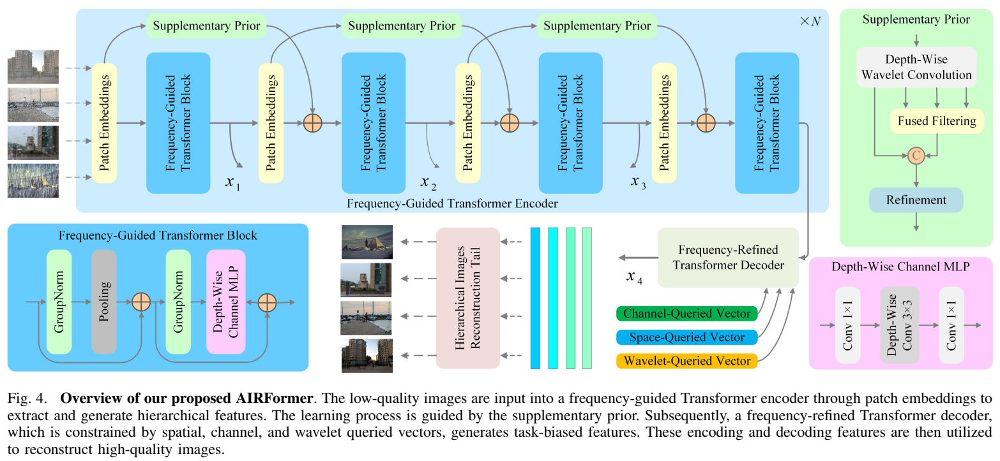
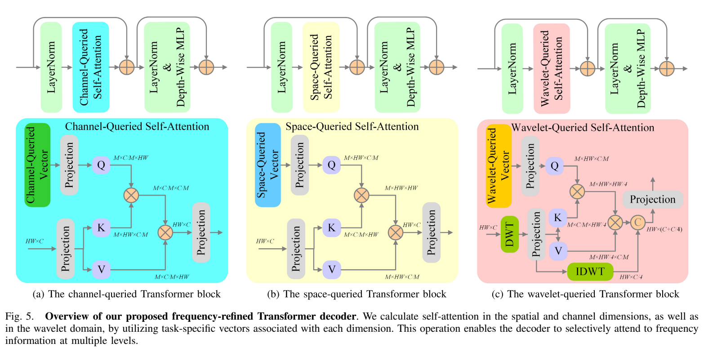

# AIRFormer: corrected graphs and remaining specification gaps

**Current claim: paper-guided implementation with explicit assumptions.**
The four encoder positions, prior routing, and Figure 5(c) wavelet graph have
been corrected. The available evidence does not establish author-implementation
equivalence. This document supersedes the earlier three-stage architecture review.

## Evidence and specification search (2026-11-02)

Primary source: the supplied 14-page publisher PDF, DOI
[10.1109/TCSVT.2023.3299324](https://doi.org/10.1109/TCSVT.2023.3299324).
The paper explicitly says supplementary material exists (page 1), and says it
contains additional dataset/training details (page 6). The locally available
file contains the main paper only.

- The paper-linked [authors repository](https://github.com/chdwyb/AIRFormer)
  returned HTTP 404 during this check.
- The [publisher article](https://ieeexplore.ieee.org/document/10196308) requires
  a JavaScript/browser verification step in automated retrieval. DOI and two
  candidate supplementary URLs did not yield a supplement. Candidate filenames
  are guesses, not confirmed publisher links; their failure does not prove the
  supplement is absent.
- Public title/DOI/supplementary searches did not recover an original implementation
  or an accessible supplementary specification. No author response was obtained
  and no email was sent: no connected email-sending tool is available.
- Corresponding author identified on page 1: Yuanbo Wen, `wyb@chd.edu.cn`;
  first author: Tao Gao, `gtnwpu@126.com`.

To close the remaining gaps, obtain the supplement/original config/code or an
author response specifying: all widths, depths, embeddings/kernels/strides,
head counts; channel/space/wavelet query tensor shapes, initialization, resolution
handling and feature composition; SP subband filters/fusion/refinement/alignment;
hierarchical reconstruction operations; wavelet family, scaling and boundary
handling; Equation 12 reduction including channel and batch axes; AIR40K file
membership, epochs, batch size and exact evaluation settings.

## Correction status

| Finding | Current implementation | Evidence/status |
|---|---|---|
| A01: encoder positions | Four positions, default widths 32/64/128/256; default depths 2/2/2/2 | Four positions match Figure 4; widths/depths remain assumptions |
| A02: SP routing | Three recurrent SPs; use preceding enhanced stage and preceding prior, inject after subsequent embedding and before block | Figure 4 / Equation 10 connection order corrected; first SP receives zeros/zeros |
| A03: SP internals | Haar, detail-band depthwise filter, 6C fusion, refinement; chosen stride-2 output alignment | Assumed; full fused-filter graph/equivalence remains unverified |
| A04: task queries | Explicit `add` or `gate` combination with projected features, broadcast learned parameters | Unresolved author parameterization; default add is an assumption |
| A05: spatial attention | Full HW-by-HW K/V by default, SDPA softmax over keys | Pooling removed from strict path; opt-in pilot approximation clearly labeled |
| A06: wavelet graph | Full-HW Q; reduced-grid C-width K/V; independent IDWT C/4 branch; concat C+C/4 then output projection | Figure 5(c) dimensions/branches corrected; projection internals assumed |
| A07: reconstruction | Three progressive bilinear/skip-concat stages and RGB head; optional image residual | Retained engineering tail pending specification |
| A08: numerical details | Haar orthonormal, replicate odd boundaries; GN(1,C), GELU/MLP ratio 2, channel L2 normalization | Assumptions; general Equation 9 does not establish these choices |
| A09: loss | Elementwise Smooth L1 mean + 0.04 DCT frequency loss | Preserved pending Equation 12 clarification |
| A10: size | Paper-guided config **2,762,691** parameters; paper **58.34M** | Still far below paper; no arbitrary padding of parameter count |

## Figure 4: encoder and priors



For a 32x32 image with `configs/paper.yaml`:

```text
RGB -> pad to multiple of 8 -> embedding -> stage0 [B,32,32,32]
  -> next embedding [B,64,16,16] + SP0(zeros, zeros)
  -> stage1 [B,64,16,16]
  -> next embedding [B,128,8,8] + SP1(stage1, SP0)
  -> stage2 [B,128,8,8]
  -> next embedding [B,256,4,4] + SP2(stage2, SP1)
  -> stage3 [B,256,4,4]
  -> assumed skip reconstruction/refinement at widths 128,64,32
  -> assumed RGB convolution and optional input-image residual -> crop
```

SP outputs align to the subsequent embedding before addition. SP0 sees zero
source features and zero prior even though stage0 has been computed. Later SPs
see the preceding post-block feature, already influenced by its own prior.
There is no SP addition after a block. Three SPs connect the four positions.
The chosen output alignment is a learned 3x3 stride-2 convolution; it is not
claimed to be the author's operator. The first embedding uses convolution/GN;
subsequent embeddings currently use convolutions, with unspecified author
normalization retained as an open detail.

The block remains GN -> pooling mixer -> residual -> GN -> depthwise-channel
MLP -> residual. `AvgPool(z)-z`, pool boundary behavior, activations, GN group
count and MLP expansion are interpretations. These must not be described as
verified numerical settings. The self-attention encoder mixer is an ablation.

## Figure 5: decoder internals



All blocks apply LayerNorm to the spatial feature before attention, add the
attention residual, then LayerNorm/depthwise MLP and the second residual. The
preferred sequence stays **Channel -> Space -> Wavelet** (Table XII).
For B=1,C=8,H=8,W=12,M=2, the strict logical attention shapes are:

| Mode | Q | K transposed in multiplication | Logits |
|---|---|---|---|
| Channel | [1,2,4,96] | [1,2,96,4] | [1,2,4,4] |
| Space | [1,2,96,4] | [1,2,4,96] | [1,2,96,96] |
| Wavelet | [1,2,96,4] | [1,2,4,24] | [1,2,96,24] |

Wavelet attention normalizes x at C channels before DWT, packs the four subbands
into 4C, and projects to C at ceil(H/2)*ceil(W/2). K/V are projected from this
reduced feature. Q comes from the full spatial grid using the explicitly assumed
task-feature combination. Independently, the shared projected coefficients are
reshaped to C/4 channels with four bands and inverted to the original H,W.
Attention output C and this IDWT output C/4 are concatenated before the final
projection to C. IDWT is not applied to the attention output. Odd sizes use
replicate extension/cropping as an explicit implementation choice.

SDPA computes scaled QK softmax over the key axis and V aggregation. For large
attention matrices, exact query chunking bounds temporary logits; each query
still attends to every key. During backward, per-chunk gradient checkpointing
recomputes attention activations. Tests compare chunked outputs and gradients
with unchunked attention and compare SDPA with explicit softmax. This is needed
on this Windows build, which has no compiled Flash Attention kernel.
`spatial_kv_pooling: true` opts into adaptive K/V pooling for resource-limited
experiments in both spatial and wavelet attention. `configs/paper.yaml` disables
it; `configs/pilot.yaml` enables it and is **not strict spatial attention**.
Full attention remains quadratic in token count; memory-efficient kernels do
not remove that compute cost.

Queries remain partially feature-derived and trainable, but the available paper
supplies no composition equation. Current channel task parameters have shape
[1,M,C/M,1]; space/wavelet parameters have shape [1,M,1,C/M]. They are not claimed
to reproduce the drawn projected task-vector parameterization. Replacing them
with arbitrary learned spatial tensors would introduce another assumption.

## Reconstruction and loss decisions

The hierarchy correction necessarily adds one chosen skip-fusion stage. The
upsampling, fusion, per-level attention stacks, single RGB head and image
residual and final clamp to [0,1] remain unverified reconstruction choices. No confirmed reconstruction
tail specification was recovered, so no new tail is presented as author code.

Equation 12 prints a signed spatial mean residual before the piecewise penalty.
Conventional elementwise Smooth L1 then averaging gives a different result:
[+1,-1,+1,-1] gives 0.5 in current code, versus 0 in the literal printed formula.
The existing loss is intentionally unchanged until author intent is established.
The DCT-II orthonormal convention, per-image channel/spatial Frobenius norm and
batch mean also remain explicit interpretations of Equation 11.

## Validation, training and compatibility

[Execution evidence](verification.json) records shapes, prior inputs, task-query
gradients, attention axes, manual-softmax/SDPA agreement, parameter count and the
loss counterexample. `tests/test_architecture_fidelity.py` checks actual preceding
feature identity, recurrent prior identity, pre-block sums, wavelet branch shape
and gradient flow through both concatenated branches. Tests establish execution
and these invariants, not equality with unpublished code.

The previous three-position diagnostic checkpoint is incompatible. Training must
start from fresh initialization; do not partially load old state or call a tiny
validation run a research reproduction. The trainer rejects an incompatible
resume configuration. Full reproduction still needs the missing architecture
specification, exact AIR40K membership, epoch/batch schedule and full test sets.
Published optimizer/crop/augmentation/evaluation settings remain in the code;
pilot deviations must be reported explicitly.

The local RTX 2000 Ada (16 GiB) passed 12 fresh real-data optimizer updates
across rain/raindrop/snow with finite gradients. A fresh strict batch-one 256x256
step passed with exact query chunking: 99.77 seconds and 0.947 GiB peak allocated
CUDA memory. Before chunking it attempted a 64 GiB allocation and failed.
[System validation](system_validation.json) records both observations. This is
pipeline/feasibility evidence, not a trained model, converged result or benchmark.

A subsequent fresh CUDA diagnostic also passed one optimizer update on each
of the four weather types, including local haze, with strict unpooled attention
and 64x64 crops. All task-query gradients were finite and nonzero. The appended
`four_weather_recheck` in the system-validation report records those results;
it does not constitute full dataset training.

| Workflow item | Published methodology | Current implementation / limitation |
|---|---|---|
| Model family | One frequency-guided encoder and frequency-refined queried-attention decoder | Same algorithm families; detailed unresolved operations listed above |
| Optimizer | AdamW, betas .9/.999, weight decay 1e-4 | Implemented |
| LR schedule | 2e-4 to 1e-7, cosine annealing | Implemented; epochs not established by main paper |
| Training crops | Random 256x256 | Paper config 256; pilot/local config 128 adaptation |
| Augmentation | Horizontal/vertical flips, 90-degree rotations, MixUp probability .5 | Implemented for paired inputs/targets; MixUp coefficient distribution assumed uniform |
| Loss | Smooth L1 + .04 frequency consistency | DCT loss implemented; Equation 12 ambiguity retained and disclosed |
| Test preprocessing | Pad symmetrically on both sides to multiples of 128, then crop | Implemented centering; reflect/replicate boundary convention is an interpretation |
| Metrics | skimage PSNR / SSIM | Implemented RGB float, data_range=1; exact author options unavailable |
| Dataset | AIR40K four-weather membership with unchanged official tests | Custom local 80/20 train/test experiment; exact AIR40K membership and haze provenance unresolved |
| Hardware | RTX 3090 | Local RTX 2000 Ada; timings are not directly comparable |

```powershell
./.venv/Scripts/python scripts/verify_paper_architecture.py
./.venv/Scripts/python -m pytest tests -q
./.venv/Scripts/python scripts/prepare_local_archives.py
```

The supplied paper and extracted figure provenance are unchanged. Semantic AST
fingerprints now differ from the historical documentation-only baseline because
this revision changes model operations; loss operations remain unchanged.

The user requested a custom **80/20 training/testing split with no validation
set**. `configs/local_available.yaml` uses this mode and includes paired local
haze data solely as a custom experiment with unverified original provenance.
Known official test releases remain separate. The trainer evaluates the custom
test set after the fixed training schedule and does not use it for checkpoint
selection. A custom split cannot reproduce the paper's canonical benchmark.
