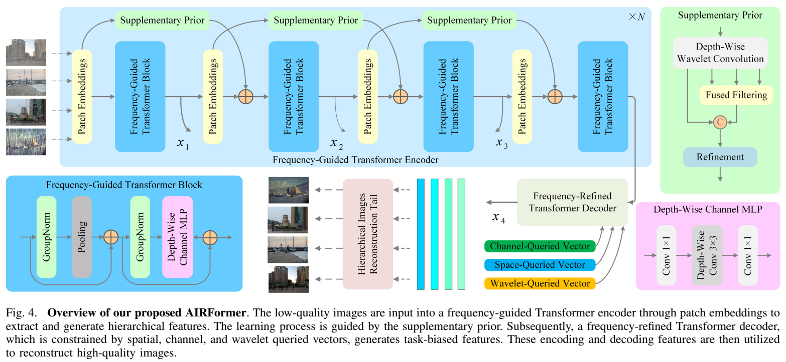
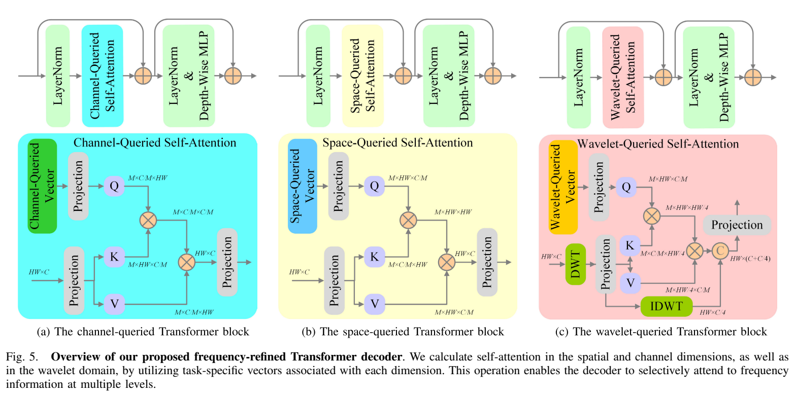
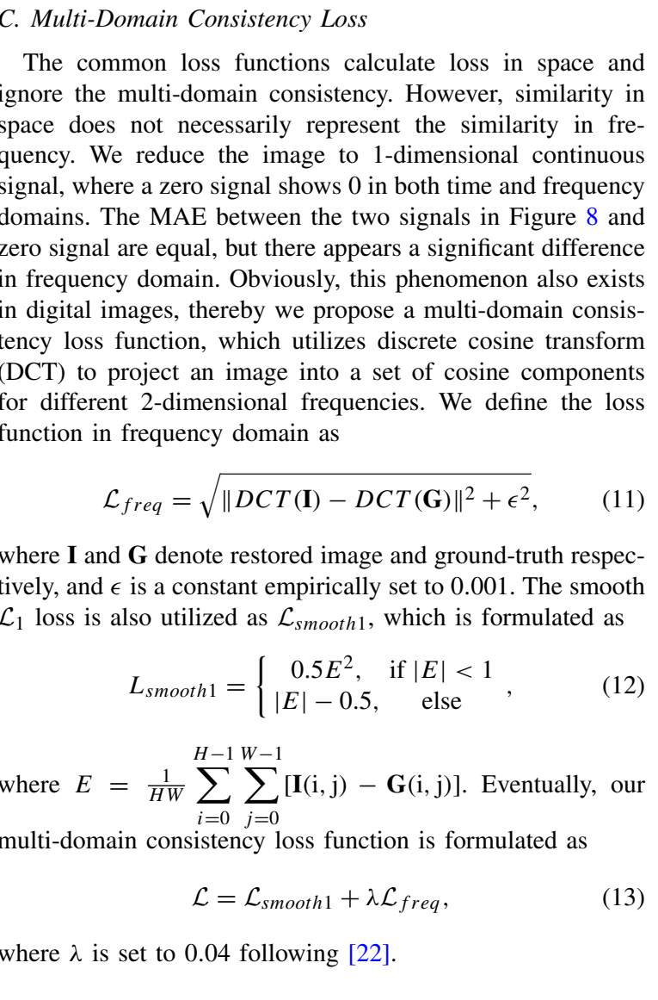
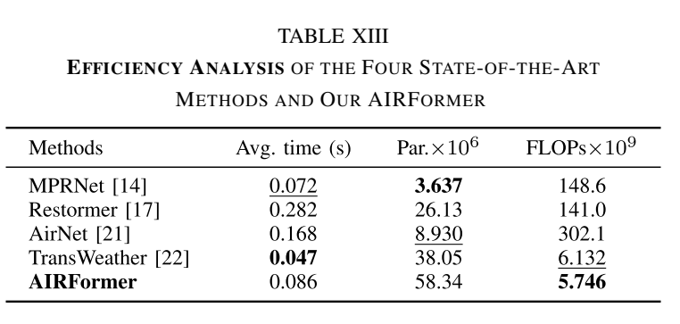

# AIRFormer architecture: paper versus actual code

**Verdict: the current code does NOT exactly implement the architecture in the
paper. It is an AIRFormer-inspired reconstruction with confirmed deviations.**

The main-paper re-verification is complete. That means the available paper has
been compared with the executed code; it does not mean the implementation has
been made compliant. No model or loss operations were changed in this review.
Model/loss semantic AST fingerprints before and after the comments are identical.

This README explains what the code actually does, where the diagrams match,
where they do not, and which details the main paper does not establish. A class
named `AIRFormer` or a passing forward test is not evidence of exact reproduction.

## Source and evidence

Primary source: Tao Gao et al., *Frequency-Oriented Efficient Transformer for
All-in-One Weather-Degraded Image Restoration*, IEEE TCSVT 34(3), 2024,
[DOI](https://doi.org/10.1109/TCSVT.2023.3299324). The user supplied the 14-page
publisher PDF in the repository root.

| Evidence | PDF page | Printed page | What was inspected |
|---|---:|---:|---|
| Figure 3(d), Figure 4 | 3 | 1888 | Shared model, encoder/SP connections, reconstruction, block internals |
| Section III introduction | 4 | 1889 | Frequency-oriented processing and claimed spatial equivalence |
| Figure 5, Equation 9, Section III-A | 5 | 1890 | Three attention graphs and wavelet definition |
| Sections III-A/B/C, Equations 10-13 | 6 | 1891 | Prior recurrence, queries, loss notation |
| Section IV-B | 8 | 1893 | Optimizer, augmentation, inference padding and metrics |
| Section V-A, Tables XII/XIII | 10 | 1895 | Attention order and reported model size |

The figures below are crops rendered from the supplied PDF, not recreated or
AI-generated diagrams. [Extraction provenance](figures/provenance.json) records
the source SHA-256, pages, crop bounds and rendering scale. The source is unchanged.
[Machine-readable execution evidence](verification.json) records actual shapes,
parameter count, gradients, a loss counterexample and semantic fingerprints.

## What matches, and what prevents an exact claim

| ID | Finding | Classification | Consequence |
|---|---|---|---|
| A01 | Figure 4 draws four encoder patch-embedding/block positions; code has three encoder levels | DEVIATION | Does not reproduce all four depicted encoder positions |
| A02 | SP is computed and added after the current encoder block | DEVIATION | Figure 4 places its addition after a subsequent patch embedding, before the next block |
| A03 | SP uses a chosen Haar/detail-filter/resize/6C-fusion/refinement graph | ASSUMED; exact diagram equivalence not established | Named SP exists and works, but is not verified as the illustrated fused-filter construction |
| A04 | Query is projected input Q plus a broadcast learned bias | ASSUMED reconstruction of text; not a literal separate task-vector projection graph | Cannot claim the exact task-query parameterization in Figure 5 |
| A05 | Spatial K/V are adaptively pooled above a token cap | DEVIATION | HW-by-HW attention in Figure 5(b) becomes HW-by-K attention |
| A06 | Wavelet attention uses reduced-grid Q, packed 4C channels and IDWT of attention output | DEVIATION | Figure 5(c) uses full-HW Q and an IDWT branch concatenated before projection |
| A07 | Two bilinear/skip decoder stages and one RGB head, optionally plus input RGB | ASSUMED tail; global RGB residual unconfirmed | The detailed hierarchical reconstruction tail is not specified or independently matched |
| A08 | Haar family, odd-edge replication, GN groups, activations, widths/depths, attention scaling | ASSUMED | Mathematical operations may be valid without being author-equivalent choices |
| A09 | Spatial loss averages elementwise Smooth L1 | DEVIATION from literal printed Equation 12; author intent unresolved | Printed equation averages the signed residual before the piecewise penalty |
| A10 | Paper config: 1,146,883 parameters; Table XIII: 58.34 million | DEVIATION | Configuration is demonstrably not the reported full model |

Verified individual matches: one shared RGB model, GroupNorm/pooling/residual
then GroupNorm/MLP/residual encoder block pattern, additive priors in general,
the first-SP zero-input condition, **Channel -> Space -> Wavelet** order,
channel-wise/spatially nonlocal attention behavior, active trainable queries,
invertible wavelet operations, and decoder residual/MLP branches. Those matches
do not cancel the graph differences above.

## Figure 4: encoder, supplementary priors and reconstruction



### What is implemented

The chosen `configs/paper.yaml` executes this path for an input `[B,3,H,W]`:

```text
RGB input
  -> pad internally to a multiple of 4
  -> PatchEmbed: 3x3 convolution, stride 1, then GroupNorm(1,C)
  -> encoder level 0: width 32, two frequency-guided blocks
  -> SP0(zeros, zeros), added AFTER that level
  -> 3x3 stride-2 convolution
  -> encoder level 1: width 64, two blocks
  -> SP1(current post-block feature, previous prior), added AFTER that level
  -> 3x3 stride-2 convolution
  -> encoder level 2: width 128, two blocks
  -> SP2(current post-block feature, previous prior), added AFTER that level
  -> bilinear upsample + encoder skip concat + 1x1 projection + 3x3 conv/GELU
  -> Channel -> Space -> Wavelet refinement at width 64
  -> same skip fusion and refinement at width 32
  -> resize to padded image size + 3x3 RGB convolution
  -> optionally add the padded input RGB image
  -> crop to original H,W
```

The encoder stores three feature tensors; the decoder starts from the deepest
one and consumes the other two as skip connections. On a 32x32 input the measured
feature shapes are `[1,32,32,32]`, `[1,64,16,16]`, `[1,128,8,8]`; decoder shapes
are `[1,64,16,16]` and `[1,32,32,32]`; RGB projection is `[1,3,32,32]`.

Code: [full model](../../models/airformer.py),
[patch projection](../../models/patch_embed.py),
[encoder](../../models/encoder.py), [decoder](../../models/decoder.py).

### Encoder block logic

For a feature tensor `x`, the pooling branch computes:

```text
z = GroupNorm(x)
x = x + (AvgPool3x3(z) - z)
x = x + MLP(GroupNorm(x))
```

The MLP is `1x1 conv -> GELU -> depthwise 3x3 conv -> GELU -> 1x1 conv`, with
hidden width `2C`. GroupNorm uses one group. These specific activation, width
and pooling-boundary choices are reconstruction choices. Figure 4 confirms the
block's normalization/mixer/residual ordering and three convolution types, but
does not supply every numerical setting. The optional encoder self-attention
mode is an ablation, not the primary pooling configuration.

### A01: three implemented encoder levels versus four depicted block positions

The figure draws four patch-embedding / encoder-block positions. Its labels x1,
x2 and x3 identify intermediate encoder features; **x4 is the decoder output**,
not a label on the fourth encoder block. `AIRFormer.__init__` rejects any `stage_blocks` length
other than three. Its `channels` tuple contains exactly three widths. Merely
changing YAML to `[2,2,2,2]` therefore cannot add the missing level.

The figure's repetition count N is not numerically specified. Do not infer
exact block depths or channel widths from the picture's number of rectangles.
The code's three-level topology is nevertheless different from the four
depicted encoder positions. Exact unpublished author settings remain unknown.

### A02-A03: supplementary-prior logic and alignment

`SupplementaryPrior` computes Haar coefficients `[B,C,4,ceil(H/2),ceil(W/2)]`.
It preserves LL at that intermediate point, depthwise-filters the other three
bands, packs them into `4C` channels, and bilinearly resizes the coefficients
back to feature resolution. It resizes/projects the previous prior as needed,
then concatenates `[current C, bands 4C, previous C]` into `6C` channels. Two
fusion convolutions and a residual refinement network return the prior.

Code: [wavelet and SP implementation](../../models/supplementary_prior.py).

This is a real, differentiable, output-affecting module. However:

- The encoder runs `stage(x)` before evaluating and adding this SP. Figure 4
  draws prior addition between the next patch embedding and the next block.
- Equation 10 uses the preceding enhanced feature and preceding prior. The code
  uses the current post-block feature at its current resolution for later SPs.
- The zero initialization for the first prior does match Equation 10. That
  isolated match does not validate the placement of the first addition.
- Figure 4 shows depth-wise wavelet convolution, fused filtering, concatenation
  and refinement. It does not establish this code's exact `6C` concatenation,
  bilinear coefficient expansion, kernels or residual refinement internals.
- No mathematical equivalence proof is supplied for the paper's stated
  spatial-equivalent wavelet construction. Explicit DWT is not automatically
  wrong, but DWT roundtrip success does not prove equivalence of the whole SP.

### A07: reconstruction

Figure 4 names a hierarchical image reconstruction tail using encoded and
decoded features. It does not specify the upsampling kernels, exact fusion,
RGB projection count or a global input-image residual. The code chooses
progressive U-shaped skip fusion followed by one RGB projection. That is a
working reconstruction strategy, not a verified literal reconstruction tail.

## Figure 5: three queried-attention mechanisms



Let `N=H*W`, `M` be the number of heads, and `d=C/M`. Batch dimension is omitted
in the figure but included in the implementation. All modes use pointwise
Q/K/V projections, softmax over the key axis and output projection.

### Channel attention: correct axis, assumed queries and scaling

Code: [QueriedAttention.forward](../../models/attention.py).

The code reshapes Q/K into `[B,M,d,N]`, normalizes their spatial vectors with
L2 normalization, adds a task bias `[1,M,d,1]` to Q, then computes a channel
attention matrix `[B,M,d,d]`. V aggregation returns the original spatial grid.
The axis agrees with Figure 5(a); the L2 normalization and `d**-0.5` scaling
are not established by the main paper. The figure labels a separate learned
channel-query vector feeding a projection. Code instead projects input features
and adds a trainable bias afterward.

The accompanying text says Q incorporates both task knowledge and features but
does not supply an exact composition equation. Therefore additive bias cannot be
verified as exact. It also cannot be rejected as violating the text simply
because the diagram does not expand that composition. The transparent status is
**ASSUMED parameterization**, not VERIFIED.

### A05: spatial attention is capped, not the drawn full attention

Q is `[B,M,N,d]`. Above the configurable token limit, K/V are generated from
adaptive average-pooled features. The actual attention shape becomes
`[B,M,N,K]`, where `K=floor(sqrt(max_spatial_tokens))**2`. The paper config uses
1024; the pilot uses 256. Figure 5(b) draws `[M,HW,HW]` attention without this
pooling. This changes the dependencies and is an explicit approximation.

It still has nonlocal influence: perturbing one location changes another
location's output in the behavior test. Nonlocality is not proof that full
spatial attention has been reproduced.

### A06: wavelet attention is a different computational graph

The difference is more substantial than the choice of wavelet family:

| Step | Figure 5(c) | Current code |
|---|---|---|
| Query token count | `HW` | `ceil(H/2)*ceil(W/2)` |
| K/V token count | `HW/4` for even dimensions | Same reduced wavelet grid, optionally pooled further |
| Attention shape | `[M,HW,HW/4]` | `[B,M,HW/4,K]` for even dimensions |
| Working channel width | Labels use `C/M` for attention and `C/4` for IDWT branch | Packs all four subbands into `4C`; head width is `4C/M` |
| IDWT role | Separate branch from projected wavelet features | Reconstructs the attention output itself |
| Fusion | Concatenate attention output with IDWT branch: `HW x (C+C/4)` before projection | No corresponding concatenate branch |
| First normalization | LayerNorm before attention module | DWT first, then LayerNorm across packed `4C` subbands |

Even when the K/V token cap is raised enough to avoid pooling, this wavelet
topology remains different. Making the wavelet grid square, renaming classes,
or testing IDWT(DWT(x)) will not fix this mismatch.

Concrete diagnostic fixture: `B=1,C=8,H=8,W=12,M=2`:

| Attention | Figure's corresponding logits dimensions | Actual, cap=16 | Actual, cap=10000 |
|---|---|---|---|
| Channel | `[1,2,4,4]` | `[1,2,4,4]` | `[1,2,4,4]` |
| Spatial | `[1,2,96,96]` | `[1,2,96,16]` | `[1,2,96,96]` |
| Wavelet | `[1,2,96,24]` | `[1,2,24,16]` | `[1,2,24,24]` |

### Verified ordering and residuals

`FrequencyRefinementBlock` executes Channel -> Space -> Wavelet, matching
Section V-A / Table XII. Channel and spatial blocks apply LayerNorm before
attention, add its residual, then apply LayerNorm/MLP and add a second residual.
The wavelet branch also adds two residuals, but its first normalization is at a
different point as documented above. GELUs and MLP expansion remain assumptions.

## A08-A10: wavelet choices, loss notation and model size

The fixed Haar basis is orthonormal and invertible to float tolerance, including
odd sizes with replication/cropping. Equation 9 names general approximation and
detail filters; the main paper does not identify Haar as the author's family.
Likewise query initialization, exact attention temperatures and normalization
settings should not be invented as confirmed paper settings.



The code's frequency term follows Equation 11's DCT residual/norm form, with
epsilon 0.001, and uses the Equation 13 weight 0.04. Orthonormal DCT-II, per-image
channel/spatial Frobenius norm and batch averaging are explicit interpretations.

**Equation 12 needs disclosure.** As printed, E is the spatial average of the
signed residual before the piecewise Smooth L1 penalty. The code applies
Smooth L1 to each residual first, then averages. With residuals `[+1,-1,+1,-1]`,
the literal printed formula gives 0; current code gives 0.5. This counterexample
is measured in `verification.json`. The printed notation may be an error or
shorthand, but no original implementation is available to establish that.
The conventional code is retained; it is not called literally exact.



The table reports 58.34M parameters, 0.086s average time and 5.746G FLOPs for
AIRFormer. The existing paper-oriented config has **1,146,883 parameters** and
the pilot has 271,155. The reported count is now directly checked against the
paper, not inferred from previous repository notes. Differences in workloads,
devices or FLOP counting cannot explain away a roughly 51-fold parameter gap.
These configurations should not be represented as the authors' full model.

## What would be required before a strict implementation claim

1. Reproduce the four depicted encoder positions and align prior injection with
   the previous-stage inputs and pre-block additions in Figure 4 / Equation 10.
2. Resolve SP's fused-filter branch construction and demonstrate any claimed
   spatial/wavelet mathematical equivalence.
3. Rebuild wavelet attention's full-resolution query and separate IDWT/concat
   routes, with the normalization position and dimensions shown in Figure 5(c).
4. Use uncapped spatial K/V in the strict path. Any pooled variant must remain
   separately labeled as a resource adaptation.
5. Resolve projected task-vector composition, widths, depths N, patch strides,
   head counts and reconstruction-tail internals from supplementary material or
   original code where available. The main paper alone is incomplete here.
6. Resolve the literal Equation 12 versus conventional Smooth L1 difference.
7. Test all corrected routes, recalculate parameter counts and evaluate trained
   weights on the correct dataset splits. Matching 58.34M alone is insufficient.

This review does not silently implement these architectural changes. They alter
the model and checkpoint layout; the requested comparison must remain honest
about the current code. Batch size and training epochs are also not supplied in
the main-paper implementation paragraph and must stay explicit assumptions.

## Reproduce this review

From the repository root, with the audit dependencies installed:

```powershell
./.venv/Scripts/python scripts/extract_paper_figures.py
./.venv/Scripts/python scripts/verify_paper_architecture.py
./.venv/Scripts/python -m pytest tests -q
```

Result during this review: **62 tests passed, zero failed, zero skipped**;
Ruff F/E9 passed for the reviewed code and new diagnostics. Model/loss semantic
AST comparison reports `true` for unchanged operations. Tests verify execution,
gradients and selected behavior; they do not turn deviations into paper matches.
The semantic baseline was captured before annotation; AST fingerprints should
be compared using the same Python version recorded in the diagnostic output.

An accurate statement for a report or presentation is:

> This project implements a working AIRFormer-inspired reconstruction with
> wavelet priors and ordered channel, spatial and wavelet attention. Comparison
> with the paper identified differences in encoder hierarchy, prior placement,
> attention/query construction, reconstruction choices and loss reduction.
> It is not an exact reproduction of the published AIRFormer architecture.

Do not state that the exact published architecture has been implemented yet.
